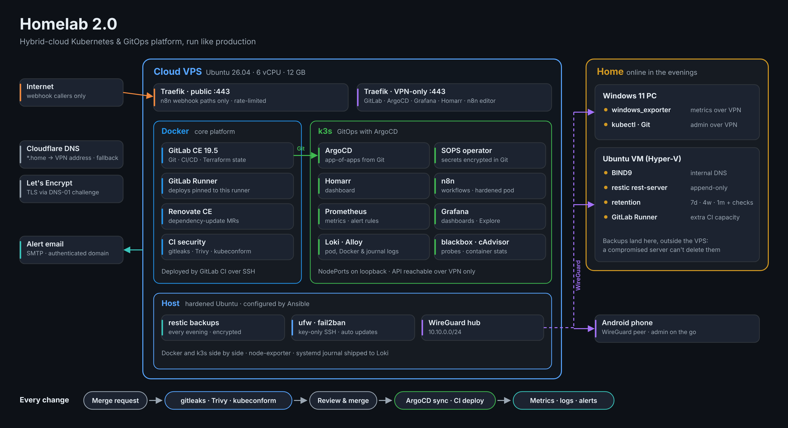

# Homelab

A self-hosted DevOps platform I build and run like production: a cloud VPS and
a home VM joined by WireGuard, with GitLab CI/CD, Kubernetes (k3s) deployed by
ArgoCD, full observability and alerting, encrypted backups, and the hosts
themselves configured with Ansible.

## Repositories

Everything runs from my self-hosted GitLab. These are public snapshots of
those repositories, with secrets replaced by dummy values.

| Repository | What it is |
|---|---|
| [gitops](https://github.com/MatejK97/gitops) | Everything on the k3s cluster, deployed by ArgoCD (app-of-apps), with SOPS-encrypted secrets |
| [ci-templates](https://github.com/MatejK97/ci-templates) | Shared GitLab CI pipelines: compose validation, SSH deploys, gitleaks and Trivy |

The rest of this page is the full write-up of how the lab is built, why, and
what went wrong along the way.

## Overview

A self-hosted lab built as a hands-on environment for learning and practicing modern DevOps and infrastructure concepts. It runs on a cloud VPS joined to the home network by a WireGuard VPN: the core platform (GitLab, GitLab Runner, Renovate and Traefik) runs in Docker, and application workloads and the observability stack (metrics, logs and alerting) run on a single-node Kubernetes cluster (k3s) deployed through GitOps with ArgoCD, with secrets stored encrypted in Git. The hosts themselves are configured with Ansible. Everything is managed through the self-hosted GitLab instance: configuration lives in Git, changes go through merge requests with automated validation, and deployments and infrastructure changes are applied by pipelines or by ArgoCD.

---

## Infrastructure Stack

**Cloud VPS**: A cloud VPS (6 vCPU, 12 GB RAM, Ubuntu Server 26.04) in a German data centre runs two container platforms side by side: Docker for the core platform services, connected through a shared user-defined bridge network (`frontend`), and k3s for application workloads and monitoring. Everything was moved here from a home VM that had run out of memory: GitLab by restoring a backup onto a fresh instance, and the Kubernetes workloads by rebuilding the cluster from the `gitops` repository and copying their data across (see Upgrades & Recovery and Kubernetes & GitOps). The full stack uses about 7.5 GB of RAM, leaving around 4 GB free; GitLab is the largest consumer and is already tuned for a single user, with one more documented step (Puma single mode, about 600 MB) held in reserve; a 4 GB swap file with low swappiness absorbs spikes without slowing normal operation. Docker logs are rotated by size so containers cannot fill the disk.

**Hardening**: SSH accepts key authentication only, for one named user, with root login disabled. `ufw` denies all inbound traffic except SSH, WireGuard and HTTP/S, `fail2ban` blocks repeated failed logins (automated root-login attempts began within hours of the server going online), and `unattended-upgrades` applies security updates automatically. All of it is applied by Ansible (see Configuration Management).

**Home — Windows 11 Pro + Ubuntu Server VM**: An Ubuntu Server 26.04 VM runs in Hyper-V on a Windows 11 Pro PC, attached to the LAN through an external virtual switch with a static address (`192.168.1.145`, configured through netplan), and starts automatically with Windows. It is managed over SSH and maintained with standard Linux tooling (apt, systemctl, journald, netplan). The VM runs the internal DNS server (BIND9), the backup repository and a second CI runner; Windows is just a client that uses it for DNS. Both machines are WireGuard peers of the VPS, and `kubectl` on Windows manages the cluster over the tunnel. The PC is usually only on in the evenings, so the home VM holds only services that tolerate gaps (see DNS, Backups and GitLab Runners).

**Network — WireGuard**: The VPS is the hub of a WireGuard VPN (`10.10.0.0/24`). The home VM and the Windows host connect to it as peers and keep the tunnel open from behind the home router with a persistent keepalive, so no ports are opened at home. Private keys stay in root-only files on each machine and are loaded when the interface starts, never written into the configuration. Docker on the VPS starts only after the tunnel is up, because services bind to the VPN address.

**Reverse Proxy — Traefik v3**: A single Traefik instance on the VPS routes all HTTP/S traffic and provisions TLS certificates automatically via a Cloudflare DNS-01 challenge (Let's Encrypt), so even VPN-only services get trusted certificates with no manual certificate management. It runs on the host network with two pairs of entrypoints, each bound to a specific address:
- **Public** (the VPS's public IP): only services explicitly routed to it are reachable from the internet. Currently that is n8n's webhook paths, on a separate hostname and rate limited.
- **Internal** (the WireGuard address): every user interface, including GitLab, ArgoCD, Grafana, Homarr, the n8n editor and the Traefik dashboard. Because these listen only on the VPN address, they cannot be exposed by a routing mistake; the same hostnames requested from the internet return 404.

HTTP is redirected to HTTPS at the entrypoint level, and header aliases (such as `X_Forwarded_For`) are stripped so backends cannot be fed spoofed headers. Docker services are discovered through container labels; Kubernetes services are routed through Traefik's file provider to fixed NodePorts on `127.0.0.1`. File-based routes are hot-reloaded, so adding one needs no restart.

**DNS — BIND9 and Cloudflare**: BIND9 9.20 runs in Docker on the home VM and serves the internal `home.matthomelab.xyz` zone, where a wildcard record points every service to the VPS's VPN address, so a new service needs no DNS change. The same wildcard is published in Cloudflare (DNS only, not proxied), so the names resolve from any network but are reachable only over WireGuard. That also makes Cloudflare a safe secondary resolver: Windows uses the home VM's BIND first and Cloudflare as backup, so name resolution keeps working whenever the VM is off or restarting. The one public hostname, for n8n webhooks, is a separate Cloudflare record pointing to the VPS's public IP.
- **Resolver**: external queries are forwarded to public resolvers, recursion is limited to internal networks, and DNSSEC validation is on, with BIND's learned trust-anchor state kept on a persistent volume.
- **Changes through CI**: the zone and configuration live in Git. Every merge request runs `named-checkconf -z`, which parses the configuration and loads every zone, and a merge deploys to the home VM and restarts BIND so the new zone is live.

---

## Configuration Management — Ansible

The host setup of both Linux machines, first done by hand, is codified in an `ansible` repository: one playbook with ten roles, run from the home VM against both hosts.
- **Scope**: on both hosts, base packages, timezone and automatic security updates, SSH hardening, WireGuard, and Docker CE with log rotation and start-after-tunnel ordering. On the VPS, additionally the firewall, fail2ban, swap, the k3s configuration and pinned install, and the backup script and timer; on the home VM, the backup retention job. Services stay in their own repositories, deployed by CI and ArgoCD. Network configuration (netplan) is deliberately left out: a mistake there takes the host off the network, so it stays a manual, console-only change.
- **Inventory and secrets**: groups for the VPS and home, and host variables for addresses and WireGuard peers. Only public keys are in the inventory: each host generates its private key itself and it never leaves the machine. The backup passwords are in Ansible Vault files, committed encrypted; the vault password is kept in a password manager and a user-only file on the control host.
- **Safe on running servers**: restarts of Docker, WireGuard and k3s are opt-in per run, and otherwise the playbook prints a reminder, because restarting Docker restarts GitLab and restarting WireGuard can cut Ansible's own connection. The SSH role refuses to disable password login without an authorized key, validates the full configuration with `sshd -t`, rolls back on failure and only reloads, so open sessions survive. k3s is installed at the pinned version if it's missing, and never upgraded by the playbook.
- **Taking over existing hosts**: each host was brought under Ansible with a dry run (`--check --diff`). Every difference was checked against the live system before applying, and the playbook was re-run until both hosts reported zero changes, so the code now describes exactly what is running.
- **CI**: `yamllint`, a playbook syntax check and `ansible-lint` on its strictest (production) profile run on every push, together with the shared security scans. The encrypted vault files are excluded from linting, and CI never connects to the hosts.

---

## Kubernetes & GitOps

**k3s**: A lightweight, single-node Kubernetes distribution (v1.36) running alongside Docker on the VPS, configured through `/etc/rancher/k3s/config.yaml`:
- **Persistent data** uses the built-in `local-path` storage class. k3s's bundled Traefik and service load balancer are disabled in favour of the shared Traefik instance.
- **NodePorts listen on loopback only** (`kube-proxy` `nodeport-addresses`). Like Docker's published ports, NodePorts are opened through iptables before `ufw` sees the traffic, so by default they would be reachable on the public IP; on loopback, only Traefik on the same host can reach them.
- **The API server is reachable over WireGuard only**: its certificate includes the VPN address, `ufw` blocks it on the public IP, and `kubectl` on Windows connects through the tunnel. `ufw` explicitly allows the pod and service networks so workloads can reach the host.

**ArgoCD**: v3.5, installed from the pinned upstream manifest with server-side apply. TLS is terminated by Traefik, so the server runs in insecure mode behind it. It continuously deploys everything in the cluster from Git, using the app-of-apps pattern:
- **One bootstrap step**: a single `root` Application is applied by hand once. It watches the `apps/` folder of the `gitops` repository, where every file is itself an ArgoCD Application. Deploying a new workload is a commit, not a command.
- **Automated sync with self-healing and pruning**: merged changes roll out within minutes, manual changes in the cluster are reverted to match Git, and resources removed from Git are removed from the cluster.
- **Least-privilege repository access**: ArgoCD reads the repository with a GitLab deploy token scoped to `read_repository` on that one project.
- **Access**: the ArgoCD UI is served at `argocd.home.matthomelab.xyz` through Traefik, with TLS terminated at the proxy.

**`gitops` repository**: Holds all Kubernetes manifests (`apps/` for ArgoCD Applications, `workloads/` for each application's resources, `bootstrap/` for the root Application). Its pipeline is validation only, because ArgoCD handles deployment:
- **`yamllint`** catches YAML syntax errors.
- **`kubeconform`** validates every manifest in strict mode against the Kubernetes schemas, including ArgoCD's custom resources via the CRD schema catalog.
- **Merges are blocked unless the pipeline passes**, a project setting managed through Terraform, so a broken manifest can never reach the cluster.
- **Renovate** watches the manifests and opens MRs for new container image versions, so an image upgrade is: Renovate MR → pipeline validation → merge → ArgoCD rollout.
- **Secrets** are committed encrypted (see Secrets management below), so the repository describes the whole cluster without exposing any credential.
- **Consistent line endings**: a `.gitattributes` file stores every text file with LF endings, so files edited on Windows can't break the YAML linter.

**Workload migrations**: The same pattern moved stateful applications twice without data loss. Each deployment is committed with zero replicas, a temporary helper pod mounts the new persistent volume, the existing data is streamed into it with `tar` over SSH, and the replica count is then raised through Git.
- **Docker to Kubernetes**: Homarr was moved from Docker Compose into the cluster, then upgraded to a new major version through the GitOps flow.
- **Cluster to cluster**: when the cluster moved from the home VM to the VPS, the new cluster was rebuilt from the `gitops` repository by applying the single `root` Application. The secrets, which at that point still lived only in the cluster (repository credentials, application encryption keys, the Grafana admin login), were copied between clusters with the cluster-specific metadata stripped, so encrypted data such as Homarr's integration credentials stayed readable. DNS was then switched to the new cluster.
- **Docker to Kubernetes, with a new exposure model**: n8n was moved from Docker Compose on the home VM into the cluster, with its encryption key moved from a file inside its volume into a Kubernetes Secret.

**Secrets management — SOPS + age**: Every application secret is committed to the `gitops` repository as an encrypted `SopsSecret`, and an operator in the cluster (sops-secrets-operator) decrypts it into a normal Kubernetes Secret.
- **Encrypted values, readable structure**: a `.sops.yaml` rule encrypts only the `data`/`stringData` values with an age key, so secret names, namespaces and keys stay visible and changes can be reviewed in merge requests without revealing anything. Editing a secret is `sops <file>`, which decrypts it in an editor and re-encrypts it on save.
- **No changes to ArgoCD**: ArgoCD applies the encrypted resources like any other manifest; only the operator holds the private key, mounted from a Kubernetes Secret.
- **Migration without downtime**: the existing hand-made Secrets were converted straight from the cluster into encrypted files (the plaintext never touched the disk) and then adopted by the operator, so the applications kept running throughout.
- **Two documented bootstrap secrets**: the age key itself and ArgoCD's repository credentials can't come from the repository they unlock. Both are created by hand in a documented rebuild procedure, and the age key is also kept in a password manager and in the encrypted backups.

---

## Services

**GitLab CE**: A self-hosted Git platform serving as the source of truth for all infrastructure configuration. Each service lives in its own GitLab repository under a `Homelab` group. GitLab is also the CI/CD engine and stores the Terraform state. It runs GitLab 19 on PostgreSQL 17 and is reachable only over the VPN: the web interface through Traefik's internal entrypoint, and Git over SSH on a port bound to the WireGuard address. It is upgraded by following GitLab's required upgrade stops, and security patch releases are applied promptly, including within days of a critical remote code execution advisory (see Upgrades & Recovery).

**GitLab Runners**: Two containerised runners using the Docker executor execute pipeline jobs for all Homelab repositories. Jobs run unprivileged and without access to the host's Docker socket, so a pipeline cannot take control of a server. Image pulls from Docker Hub are authenticated with a read-only access token to avoid rate limits, and each runner's configuration, which holds its tokens, is kept out of Git.
- **VPS runner**: always online; tagged `vps`. Deploy jobs are pinned to it, because the deploy key only works from the VPS's Docker network.
- **Home runner**: on the home VM, connected over WireGuard and limited to two concurrent jobs. When the PC is on, it shares validation and security-scan jobs with the VPS runner; when it's off, GitLab simply sends everything to the VPS. It never receives deploy jobs or the deploy key.

**Shared CI/CD Template (`ci-templates`)**: A dedicated repository holds one reusable pipeline for all Docker Compose services. Each service repository's `.gitlab-ci.yml` is a short `include` that sets only its compose file name. The template provides:
- **Merge request validation**: `docker compose config` checks the compose file's syntax and structure before anything can be merged.
- **Automatic deployment on merge to `main`**: the pipeline connects to the VPS over SSH in a single session, fast-forward pulls the repository, pulls the new images and recreates only the containers whose image or configuration changed.
- **Scoped deploy key**: deployments use a dedicated SSH key that only CI uses, stored as a protected, file-type group variable so only `main` pipelines receive it. On the server the key is restricted with `from=` to Docker's private address range, so a leaked copy cannot be used from anywhere else.
- **Safety controls**: `set -e` stops a deploy at the first failure, `--ff-only` refuses to deploy over manual edits on the server, and resource groups prevent overlapping deploys of the same service.
- **Other hosts and restarts**: a service repository can override the target host (the home VM is reached over WireGuard, still from the VPS runner, with the deploy key additionally restricted to the VPS's tunnel address on that host) and can opt in to a restart after deploy, for services such as BIND that only read their mounted configuration at startup.
- **Self-hosting exceptions**: GitLab and the GitLab Runner validate only and are deployed manually, since a pipeline cannot safely restart the platform it runs on.

**Security scanning (`ci-templates/security.yml`)**: Compose services get these jobs through the shared template; the `gitops` and Terraform repositories include the same file.
- **gitleaks** scans the new commits of every merge request and every push to `main`, and blocks the pipeline if they contain a secret. A manual job scans a repository's entire history on demand.
- **Trivy image scanning** runs when a merge request changes a compose file (usually a Renovate version bump), so each new image is checked for known high and critical vulnerabilities before it's merged. It reports without blocking, because large images always carry some CVEs.
- **Trivy configuration scanning** checks Kubernetes manifests and Terraform for misconfigurations. Findings were either fixed (n8n now runs with a read-only root filesystem and no Linux capabilities; Homarr has a restricted security context) or recorded in a `.trivyignore.yaml` with a written reason for each accepted risk, such as cAdvisor needing privileged access to read container stats.
- **History cleanup**: the first full-history scan found secrets committed early on in two repositories (a GitLab token, a Cloudflare API token, certificate keys and runner tokens). Each one was confirmed dead or rotated first, then the files were removed from history with `git filter-repo`, force-pushed, and purged from the GitLab server with its repository cleanup. A follow-up scan came back clean.

**Renovate CE**: A self-managed instance of Mend Renovate connected to GitLab. It automatically opens merge requests to bump Docker image versions in compose files and Kubernetes manifests, Terraform providers and other dependencies across all Homelab repositories. Every Renovate MR is validated by the same pipelines as manual changes, and major-version bumps are reviewed before merging. It publishes no ports at all: GitLab delivers webhooks to it over the internal Docker network, and Renovate creates and maintains those webhooks on each project itself, verified with a shared secret.

**Terraform (GitLab Provider)**: Infrastructure as Code for the GitLab instance itself. GitLab projects, groups, memberships and project settings (such as requiring passing pipelines before merge) are declared in `.tf` files, with resource references so Terraform resolves creation order automatically. The pipeline works as follows:
- **State**: stored in GitLab-managed Terraform state (HTTP backend) with locking and version history, authenticated with the job's own CI token.
- **Merge requests**: `terraform fmt`, `validate` and `plan` run automatically, and the plan summary (resources to add, change or destroy) is shown in the MR.
- **`main` branch**: the saved plan is applied through a manual approval step, so nothing changes without the plan being reviewed.
- **Least-privilege tokens**: plans use a read-only API token; the full-access token is a protected variable available only to `main` pipelines.
- **Reproducibility**: the provider lock file is committed with checksums for both Windows and Linux, and the Terraform version is pinned to match local tooling.
- **State maintenance**: drift between the configuration and the recorded state was corrected with `terraform state rm` and `terraform import` instead of destroying and recreating live resources.
- **Retiring services**: projects for retired services are archived through Terraform rather than deleted, so their history stays available read-only.

**Homarr**: A self-hosted dashboard that provides a unified view of all running services. Runs in Kubernetes, deployed by ArgoCD from the `gitops` repository.

**n8n**: A self-hosted workflow automation platform for building and running automated pipelines and integrations. Runs in Kubernetes, deployed by ArgoCD, with a split exposure model:
- **Editor, API and login**: reachable only over WireGuard, at `n8n.home.matthomelab.xyz`.
- **Webhooks**: a separate public hostname routes only the `/webhook/` and `/webhook-test/` paths to n8n, with a rate limit, so outside services can trigger workflows while the editor stays unreachable from the internet, even by guessing URLs.
- **Credentials**: the key that encrypts saved credentials lives in a Kubernetes Secret instead of only inside the data volume.
- **Hardened container**: runs as a non-root user with a read-only root filesystem, no Linux capabilities and no privilege escalation; only its data volume and two scratch folders are writable.

---

## Observability: Metrics, Logs & Alerting

**kube-prometheus-stack**: Prometheus, Grafana, Alertmanager, node-exporter and kube-state-metrics, deployed by ArgoCD from two sources: the Helm chart comes from the upstream repository at a pinned version, and its values file comes from the `gitops` repository, so configuration changes are reviewed in merge requests and chart upgrades arrive as Renovate MRs. Control-plane components that k3s embeds in a single process are excluded from scraping to avoid false alerts, Prometheus retention is limited by both time and size, memory limits keep the stack within the server's budget, and Grafana's admin login comes from a Kubernetes Secret rather than Git.

**What is collected**: every source is declared in Git, either as a `ServiceMonitor` for workloads in the cluster or as a `ScrapeConfig` for targets outside it.
- **The VPS and the cluster**: host metrics from node-exporter, and pod and cluster state from the kubelet and kube-state-metrics.
- **Docker containers**: cAdvisor runs as a DaemonSet and reports CPU, memory and network for the Docker services (GitLab, Traefik, the Runner, Renovate) by their compose service names. Collection is tuned down (30-second housekeeping, unused metric groups disabled) to keep its own footprint small.
- **Traefik**: its built-in Prometheus endpoint, on a dedicated entrypoint bound to the WireGuard address, gives request rates, error rates and latency per router.
- **Windows desktop**: `windows_exporter` runs as a Windows service. The Windows Firewall rule for its port accepts only the VPS's VPN address, so the metrics are reachable through the tunnel and nowhere else on the LAN.
- **Every service, from the outside**: blackbox-exporter probes each service through its real HTTPS URL every minute, testing DNS, Traefik, the certificate and the application together, the same path a user takes.

**Logs — Loki + Grafana Alloy**: Loki stores logs in single-process mode on a local volume with 7 days of retention, matching Prometheus. The chart's scalable components and memory-heavy caches are switched off, so it fits in a few hundred MB. Alloy runs as a collector on the node and ships three sources:
- **k3s pods**, read through the Kubernetes API and labelled with namespace, pod and container.
- **Docker containers**, through the Docker socket and labelled with their compose service name, so GitLab, Traefik, the Runner and Renovate are searchable by name.
- **The systemd journal**, labelled by unit, covering SSH logins, fail2ban bans, WireGuard, k3s and the backup service.

Grafana has Loki as a second data source, so logs and metrics for the same moment sit side by side, and LogQL queries can turn logs into graphs (for example log volume per container, or GitLab requests with a 5xx status).

**Alert rules**: on top of the stack's built-in Kubernetes and node rules, a `PrometheusRule` in Git adds:
- **Service down**: any probed service unreachable for 5 minutes (critical).
- **Docker container missing**: any compose service seen in the last day that is no longer running (critical). This covers services with no URL to probe, such as Renovate and the Runner, and is guarded on cAdvisor being up, so a monitoring outage doesn't fire one alert per container.
- **Host pressure**: sustained swap use and high CPU on the VPS (warning), complementing the built-in disk and memory rules.
- **Backups**: no successful backup for four days, or no backup status at all (warning).
- **Windows resources**: low disk space, low memory and sustained high CPU (warning). There is deliberately no "Windows is down" alert: when the PC is switched off there is simply no data, rules without data don't fire, and the built-in `TargetDown` alert is routed away for this one job, so a normal shutdown never sends an email.

**Notifications**: Alertmanager sends email through a transactional mail service over SMTP with STARTTLS, from a dedicated sending subdomain with its own SPF and DKIM records, so alert mail is authenticated and kept separate from the domain's regular mailbox. The SMTP key is a Kubernetes Secret mounted into Alertmanager. Routing keeps the inbox meaningful: related alerts are grouped into one email, a still-firing alert repeats only twice a day, a critical alert suppresses the matching warning, resolved alerts send a follow-up, and informational alerts stay visible in Alertmanager without emailing. The full chain was tested end to end by stopping a container and receiving both the firing and the resolved email, and it has since caught a real outage.

**Dead man's switch**: if the VPS, the cluster or Alertmanager itself fails, nothing is left to send an alert. Alertmanager therefore forwards the always-firing `Watchdog` alert every minute to an external heartbeat service (healthchecks.io), which emails when the heartbeats stop. The ping URL is stored as an encrypted secret and read from a mounted file, so it never appears in the configuration.

---

## Backups

The VPS is backed up with restic to the home VM over WireGuard. Because the home VM only runs in the evenings, a fixed nightly schedule wouldn't work; instead the backup adapts to when home is online:
- **Schedule**: a systemd timer tries every 15 minutes, and the script runs only when the home VM is reachable and the last successful backup is more than 20 hours old. In practice that is one backup per evening, shortly after the PC starts.
- **Contents**: a consistent GitLab application backup (`gitlab-backup create`) together with `gitlab-secrets.json` and its configuration; every Docker service's folder, including its `.env` and configuration; `/etc` (WireGuard, SSH, firewall, k3s configuration); the k3s persistent volumes; and an export of the Kubernetes Secrets that aren't in Git. GitLab's live database files and the Prometheus and Loki data are excluded: the first is covered by the consistent backup, the others can be rebuilt. Secrets are staged in a root-only folder that is removed even if the backup fails.
- **Append-only storage**: the home VM runs restic's `rest-server` in append-only mode, bound to the WireGuard address. The VPS can add snapshots but never delete or overwrite them, so a compromised VPS can't destroy its own backups.
- **Retention and integrity**: pruning (7 daily, 4 weekly, 1 monthly) runs on the home VM, followed by a repository check that reads back a sample of the stored data each run.
- **Encryption**: restic encrypts everything before it leaves the VPS. The encryption password is also kept outside the VPS, since a backup that needs the lost server to decrypt it would be useless.
- **Monitoring**: the script publishes its last-success time through node-exporter's textfile collector, and Prometheus alerts if no backup has succeeded for four days.
- **Restore test**: a snapshot was restored on the home VM and verified: the GitLab backup archive was readable, `gitlab-secrets.json` and the Kubernetes Secrets were present, and both application databases (copied while running) passed SQLite's integrity check.

---

## Upgrades & Recovery

Upgrades follow a documented, repeatable process:
- **Before upgrading**: a snapshot of the host, a GitLab backup (`gitlab-backup create`) plus copies of `gitlab.rb` and `gitlab-secrets.json`, and a record of the running version, volume mounts, configuration and webhook settings.
- **During**: GitLab is upgraded one required stop at a time, using the latest patch of each stop, and only after background migrations from the previous version have finished. Database prerequisites (such as PostgreSQL 17 for GitLab 19) are verified between stops.
- **After**: the version, database and `gitlab:check` results are verified, and webhook settings are compared against the pre-upgrade record so silent configuration resets are caught immediately.

**Migration as a restore drill**: GitLab was moved to the VPS through its backup and restore process rather than by copying data directories. A fresh instance of the exact same version was started, its application services (Puma and Sidekiq) were stopped, and the backup was restored together with the original `gitlab-secrets.json`. `gitlab:check` and `gitlab:doctor:secrets` then confirmed that all encrypted data (CI/CD variables, tokens, runner registrations) could still be decrypted. DNS was switched to the new address, and the old instance was kept stopped as a fallback. The move doubled as a full test that the backups can actually be restored.

A `containers` command (a Bash script) on the home VM starts, stops, restarts and reports on the Docker services in dependency order, waiting for each service's healthcheck instead of using fixed delays, and can act on individual services.

---

## Deployment & Troubleshooting

When a service misbehaves, the standard troubleshooting workflow involves checking container logs (`docker logs`, `docker compose logs`), inspecting running container state (`docker ps`, `docker inspect`), reviewing Traefik routing rules, validating DNS resolution with `dig` and `nslookup` (including from inside a container on the same Docker network), and testing end-to-end routing with `curl`. On Kubernetes, the same approach uses pod events, probe results and logs (`kubectl get events`, `kubectl describe`, `kubectl logs --previous`). System-level issues are investigated through `journald` logs and `systemctl` service status. Pipeline failures are diagnosed from job logs, covering rules evaluation, Runner configuration and registry authentication.

Example: after installing ArgoCD, its server and controller pods kept restarting. Pod events showed liveness probe failures, and the controller's logs showed the Kubernetes API server timing out on ArgoCD's own custom resources. DNS and in-cluster networking were ruled out step by step, the API server's request handling was confirmed stuck, and restarting k3s resolved it.

All compose files, manifests and configuration are version-controlled in GitLab, so a misconfigured deployment can be traced through Git history and rolled back by reverting a merge request.

---

## Lessons Learned

- **Docker publishes ports around the firewall.** Ports published by Docker are handled by Docker's own iptables rules before `ufw` sees the traffic, so a `ufw` rule does not protect them. Admin ports on the VPS are therefore bound to the WireGuard address (for example `10.10.0.1:2424:22` for Git over SSH), and Traefik runs on the host network so that each entrypoint binds an exact address and `ufw` applies to it.
- **Git can delete files it ignores.** Two secret files, the runner's configuration and Traefik's certificate store, had been committed early on and were later removed from Git and ignored. Switching to an older branch where they were still tracked overwrote the local copies, and pulling the commit that untracked them deleted them. The runner's configuration was recovered from the running container, which still held the deleted file open, and Traefik reissued its certificates. Secret files are now ignored before their first commit, and the old commits containing them must be purged from history before any repository is made public.
- **Rotate first, then rewrite history.** A full-history secret scan found credentials committed months earlier. Rewriting Git history doesn't undo exposure that has already happened (clones, merge request refs and old pipelines keep copies), so each secret was first checked against the live service (a leaked GitLab token turned out to be already invalid), rotated if still live, or revoked by deleting the runners it belonged to. Only then was the history cleaned, and every clone, including the deploy checkout on the server, was reset to the rewritten history.
- **Kubernetes NodePorts bypass the firewall the same way.** `kube-proxy` opens NodePorts through iptables rules that run before `ufw`, on every interface by default. Knowing this from the Docker case, k3s was configured before installation to open NodePorts on loopback only, and a request to a NodePort on the public IP was tested to confirm it is refused.
- **"Up" is not "working".** After cAdvisor was deployed, its scrape target showed as up, but no container data ever arrived, for two separate reasons. First, cAdvisor needs Docker's containerd socket as well as the Docker socket, and narrowing its mounts had removed it, so it registered no Docker containers at all; its startup log said so. Second, a ServiceMonitor rule meant to drop series with an empty `name` label had `regex: ""`, which the Prometheus Operator treats as unset, so Prometheus used the default `(.*)` and dropped every series. Comparing `scrape_samples_scraped` with `scrape_samples_post_metric_relabeling` showed exactly where the data disappeared. New metric sources are now checked by querying the data itself, and alert rules by triggering them for real.
- **A trust anchor that lived in the wrong place.** After a container recreation, BIND 9.16 suddenly rejected every DNS answer. The DNS root zone had just started signing with a new key, and the old BIND only had the previous key built in; the newer key it had learned automatically was stored inside the container instead of on the mounted volume, so recreating the container erased it. The fix was upgrading to BIND 9.20 (which ships the new key), pointing BIND's working directory at the persistent volume, and verifying DNSSEC with a deliberately broken test domain.
- **A nested hypervisor is not a free lunch.** On a Windows host with Hyper-V enabled, VirtualBox runs through Hyper-V's compatibility layer. It worked until a guest kernel upgrade, after which boots hung on lost timer and disk interrupts. Rather than tuning around it, the VM's disk was converted and the VM moved to Hyper-V itself, with the original disk kept as a fallback. The network configuration was made to match by interface name, since the virtual network card's name changed.
- **A green deploy that changed nothing.** A configuration-only change deployed successfully but wasn't applied, because `docker compose up -d` only recreates containers when the compose file changes. Services that read mounted configuration at startup now opt in to a restart in the shared deploy template.
- **Codifying a hand-built server is an audit.** The first Ansible dry runs found drift nobody had noticed: the Ubuntu release upgrade had disabled the home VM's Docker package source, so Docker there had silently stopped receiving updates, and its container logs had no size limit. The restic password files on the two hosts also differed, which turned out to be only a trailing newline; the contents were compared by checksum before Ansible was allowed to overwrite one. Reading every line of the diff before applying turned these into fixes instead of surprises.
- **A dry run skips the commands that would inform it.** In check mode, Ansible skips shell commands, including read-only ones such as `k3s --version`, so tasks that used their output printed empty values or failed. Read-only commands are marked `check_mode: false`, so dry runs see the real system.
- **Docker's DNS can shadow a public hostname.** On the shared `frontend` network, Docker's internal DNS answered GitLab's public hostname with the GitLab container's own address, because the container's hostname matches it. Renovate therefore bypassed Traefik and tried HTTPS directly against a container that serves only plain HTTP, and the connection was refused. Pinning the name to the VPN address with `extra_hosts` sends the traffic through Traefik and TLS as intended.

---

## Key Concepts Demonstrated

- **Linux Administration**: Ubuntu Server managed via SSH on a home VM and a cloud VPS, including package installation, service management and systemd ordering, static network configuration with netplan, and system-level debugging using standard Linux tools.
- **Server Hardening**: key-only SSH for a single user, a default-deny firewall, `fail2ban` and automatic security updates on an internet-facing server.
- **Networking & VPN**: a hub-and-spoke WireGuard network joining a cloud server, a home VM, a Windows host and a phone, with admin services reachable only through the tunnel.
- **Virtualization**: Hyper-V on Windows 11 Pro (Generation 1 VM, external virtual switch), including migrating a VM from VirtualBox by converting its disk.
- **Containerisation**: Every service runs in a container, with compose files and Kubernetes manifests explicitly defining images, persistent volumes, configuration mounts, networks and environment variable injection.
- **Kubernetes**: k3s with Deployments, Services, PersistentVolumeClaims, Secrets, security contexts, health probes and resource requests and limits, with NodePorts and the API server kept off the public interface.
- **GitOps**: ArgoCD with the app-of-apps pattern, automated sync, self-healing and pruning, so Git is the single source of truth for the cluster.
- **Reverse Proxy & TLS Automation**: one Traefik instance with a Cloudflare DNS challenge, separate public and VPN-only entrypoints, and no manual certificate work.
- **Self-hosted CI/CD**: GitLab with two runners (always-on cloud and part-time home capacity, with deploys pinned by tag) and a shared, reusable pipeline template that validates merge requests and deploys automatically on merge, plus schema validation for Kubernetes manifests.
- **DevSecOps**: secret detection (gitleaks) and vulnerability and misconfiguration scanning (Trivy) in every pipeline, with documented risk acceptance, workload hardening driven by the findings, and a full secret-history cleanup with credential rotation.
- **Infrastructure as Code**: Terraform managing GitLab's own configuration through a plan-on-MR, approve-to-apply pipeline with remote, locked state.
- **Configuration Management**: Ansible roles for hardening, VPN, Docker, k3s and backups across two hosts, with Vault-encrypted secrets, linting in CI, opt-in restarts, and a dry-run-first rollout verified to be idempotent.
- **Security**: Unprivileged CI jobs without Docker socket access, a source-restricted CI deploy key, least-privilege API and deploy tokens, protected variables limited to `main`, merges gated on passing pipelines, prompt security patching, and secrets committed only in encrypted form.
- **Secrets Management**: SOPS with age keys and an in-cluster operator, so secrets live encrypted in Git, change through reviewed merge requests and are applied by GitOps, with a documented bootstrap for the two keys that unlock everything else.
- **Backup & Recovery**: encrypted, deduplicated restic backups to append-only off-site storage, scheduled around when the target is online, with retention, integrity checks, monitoring and a verified restore.
- **Automated Dependency Management**: Renovate CE opening MRs for image, provider and package updates across Docker and Kubernetes, gated by pipeline validation.
- **Observability**: metrics with kube-prometheus-stack (cluster, Docker containers via cAdvisor, Traefik, a Windows host over VPN and external HTTPS probes via blackbox-exporter) and centralised logs with Loki and Grafana Alloy (pods, Docker containers and the systemd journal), all deployed through GitOps, with alert rules as code and authenticated email notifications routed to avoid noise.
- **Migration & Upgrade Management**: Moving the platform to a cloud server through a backup-and-restore drill, rebuilding a Kubernetes cluster on new hardware from Git, moving stateful services from Docker to Kubernetes and between clusters without data loss, and planned GitLab upgrades through required upgrade stops with snapshots, backups and post-upgrade verification.
- **DNS**: BIND9 providing split-horizon DNS for internal services with DNSSEC validation, deployed and validated through CI, plus a Cloudflare wildcard that resolves publicly but points only to a VPN address and doubles as a fallback resolver.
- **Troubleshooting**: Log-, event- and metric-driven debugging across Docker, Kubernetes, Traefik, DNS, Prometheus, journald and CI job logs, plus packet capture (`tcpdump`) to follow traffic through the VPN, with Git history as an audit trail for configuration changes.
